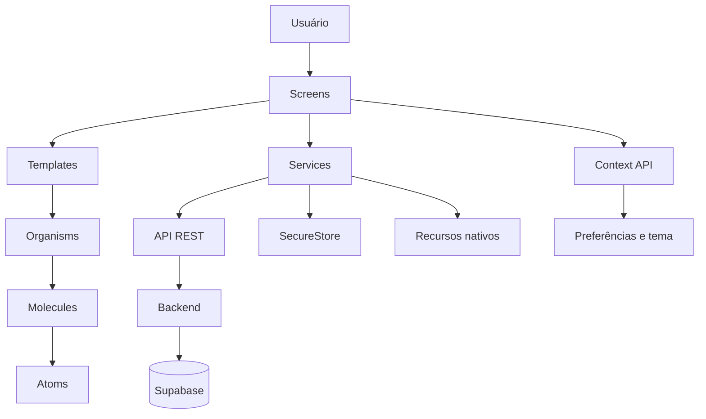
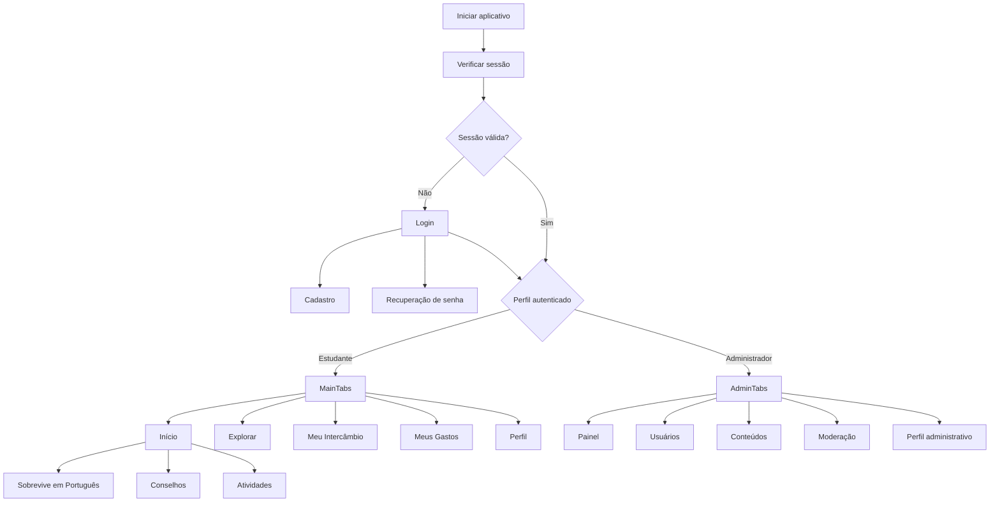
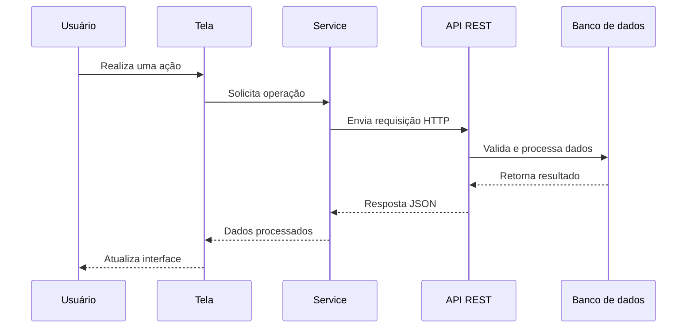

# InterChapecó — Frontend

## 1. Sobre o projeto

O InterChapecó é uma aplicação móvel desenvolvida para
auxiliar estudantes de intercâmbio durante sua experiência
acadêmica e pessoal na cidade de Chapecó, Santa Catarina,
Brasil.

A aplicação reúne ferramentas de organização pessoal,
controle financeiro, aprendizado do português, exploração
da cidade e interação entre estudantes de diferentes países.

O frontend é responsável pela interface gráfica,
experiência do usuário, navegação, gerenciamento de sessões,
utilização dos recursos nativos do dispositivo e comunicação
com a API REST do InterChapecó.

O projeto foi desenvolvido como trabalho acadêmico da
disciplina de Desenvolvimento para Dispositivos Móveis
da Universidade Comunitária da Região de Chapecó
(Unochapecó).

## 2. Objetivos

- Facilitar a adaptação dos estudantes de intercâmbio.
- Centralizar informações importantes sobre Chapecó.
- Auxiliar na organização das atividades acadêmicas e pessoais.
- Facilitar o gerenciamento das despesas mensais.
- Apoiar o aprendizado do português.
- Promover a interação entre estudantes.
- Disponibilizar uma interface intuitiva e responsiva.
- Oferecer recursos de administração e moderação.
- Integrar funcionalidades nativas dos dispositivos móveis.

## 3. Tecnologias utilizadas

| Tecnologia | Finalidade |
|---|---|
| JavaScript | Linguagem de programação |
| React 19.2.3 | Desenvolvimento de componentes |
| React Native 0.86.3 | Desenvolvimento móvel |
| Expo SDK 57 | Ambiente de desenvolvimento |
| Expo Dev Client | Compilação e execução personalizada |
| React Navigation | Gerenciamento da navegação |
| Context API | Gerenciamento de preferências globais |
| Expo SecureStore | Armazenamento seguro de dados |
| AsyncStorage | Compatibilidade e migração de dados locais |
| Expo ImagePicker | Acesso à câmera e galeria |
| Expo Location | Geolocalização |
| Expo Notifications | Notificações locais |
| Expo Speech | Síntese de voz |
| Expo FileSystem | Manipulação de arquivos |
| React Native Maps | Exibição de mapas interativos |
| Google Maps SDK | Serviço de mapas no Android |
| Expo Vector Icons | Ícones da interface |
| Expo Linear Gradient | Recursos visuais |
| Git e GitHub | Controle de versão |
| ClickUp | Gerenciamento do projeto |

## 4. Arquitetura da aplicação

O frontend utiliza uma arquitetura modular baseada em
componentes reutilizáveis, separando a interface gráfica,
navegação, serviços, estado global e funções auxiliares.

A organização dos componentes segue os princípios
da metodologia Atomic Design.



## 5. Atomic Design

Atomic Design é uma metodologia de organização de
interfaces que divide os componentes em diferentes níveis
de responsabilidade e complexidade.

A utilização dessa metodologia facilita a reutilização
de componentes, manutenção do código e consistência visual.

### 5.1. Atoms

Representam os componentes básicos da interface.

Exemplos:

| Componente | Responsabilidade |
|---|---|
| Button | Botões reutilizáveis |
| Input | Campos de entrada |
| Card | Estrutura básica de cartões |
| Checkbox | Seleção de opções |
| Chip | Elementos de identificação |
| Etiqueta | Identificação de categorias e estados |
| Logo | Identidade visual do aplicativo |
| ProgressBar | Indicadores de progresso |
| BotaoIcone | Botões com ícones |
| BotaoVoltar | Navegação de retorno |
| BotaoFlutuante | Ações rápidas |
| FotoLocal | Exibição de imagens |
| AvatarIcone | Representação visual de usuários |
| Pill | Indicadores visuais compactos |

### 5.2. Molecules

Representam combinações de componentes básicos que
formam elementos com responsabilidades específicas.

Exemplos:

| Componente | Responsabilidade |
|---|---|
| BarraBusca | Pesquisa de conteúdos |
| FormField | Campos de formulário com identificação |
| CampoSelecao | Seleção de opções |
| BotaoSegmentado | Alternância entre opções |
| CardLocal | Apresentação de lugares |
| CardAtividade | Apresentação de atividades |
| CardConselho | Apresentação de conselhos |
| CardGasto | Apresentação de despesas |
| CardAdmin | Apresentação de informações administrativas |
| CardInfo | Indicadores e informações resumidas |
| ItemTarefa | Apresentação de tarefas |
| ItemFrase | Apresentação de frases |
| ItemComentario | Apresentação de comentários |
| ItemFavorito | Apresentação de conteúdos favoritos |
| SeletorImagem | Seleção de fotografias |
| SeletorMes | Seleção de períodos mensais |
| GraficoBarras | Visualização de dados financeiros |

### 5.3. Organisms

Representam estruturas mais complexas, compostas por
átomos e moléculas.

Exemplos:

| Componente | Responsabilidade |
|---|---|
| LoginForm | Formulário de autenticação |
| RegisterForm | Formulário de cadastro |
| RecoverPasswordForm | Recuperação de senha |
| ResumoInicio | Indicadores da tela inicial |
| ListaLocais | Listagem de lugares |
| FiltrosExplorar | Filtros de exploração |
| MapaLocais | Mapa interativo dos lugares |
| DetalheLocal | Informações detalhadas de lugares |
| ListaTarefas | Organização das tarefas |
| FormularioTarefa | Cadastro e edição de tarefas |
| DetalheTarefa | Informações detalhadas da tarefa |
| ResumoGastos | Resumo financeiro |
| HistoricoGastos | Histórico de despesas |
| EstatisticasGastos | Visualização de estatísticas |
| FormularioGasto | Cadastro e edição de despesas |
| FormularioOrcamento | Configuração do orçamento |
| ListaCategoriasFrases | Organização das categorias de frases |
| DetalheFrase | Tradução, contexto e pronúncia |
| FormularioConselho | Cadastro e edição de conselhos |
| DetalheConselho | Informações das publicações |
| ComentariosConselho | Gerenciamento de comentários |
| FormularioAtividade | Cadastro e edição de atividades |
| DetalheAtividade | Informações de atividades |
| ListaAdmin | Listagens administrativas |
| FormularioAdmin | Gerenciamento de conteúdos administrativos |

### 5.4. Templates

Definem estruturas reutilizáveis para organizar
o conteúdo das telas.

| Template | Responsabilidade |
|---|---|
| CenteredTemplate | Estrutura das telas de acesso |
| ScreenTemplate | Estrutura das telas internas |

Os templates auxiliam na padronização de espaçamentos,
cabeçalhos, áreas seguras e organização visual.

### 5.5. Screens

Representam as telas completas da aplicação.

São responsáveis por integrar componentes, controlar
o estado local, executar operações dos serviços
e realizar a navegação.

## 6. Estrutura do projeto

```text
PROYECTO-DISPOSITIVOS-MOVEIS/
│
├── assets/
│   ├── icon.png
│   ├── splash-icon.png
│   └── outros recursos visuais
│
├── src/
│   ├── components/
│   │   ├── atoms/
│   │   ├── molecules/
│   │   ├── organisms/
│   │   └── templates/
│   │
│   ├── constants/
│   ├── contexts/
│   │   └── PreferenciasContext.js
│   │
│   ├── navigation/
│   │   ├── AdminTabs.js
│   │   ├── MainTabs.js
│   │   ├── InicioStack.js
│   │   ├── ExploreStack.js
│   │   ├── IntercambioStack.js
│   │   ├── GastosStack.js
│   │   └── PerfilStack.js
│   │
│   ├── screens/
│   ├── services/
│   ├── theme/
│   └── utils/
│
├── .env.example
├── .gitignore
├── App.js
├── app.json
├── app.config.js
├── index.js
├── package.json
├── package-lock.json
└── README.md
```

As pastas nativas `android/` e `ios/` podem ser geradas
pelo Expo durante o processo de compilação.

## 7. Navegação

A aplicação utiliza React Navigation para organizar
a navegação entre as telas.

São utilizados dois tipos principais de navegação:

- Native Stack Navigator.
- Bottom Tab Navigator.

O arquivo `App.js` configura a navegação principal,
o gerenciamento de temas e a seleção da interface
de acordo com o perfil autenticado.



### 7.1. Navegação do estudante

O estudante possui uma interface voltada à organização
do intercâmbio, exploração de Chapecó e utilização
dos recursos comunitários.

A navegação principal está definida em:

`src/navigation/MainTabs.js`

### 7.2. Navegação do administrador

O administrador possui uma interface específica para
gerenciamento de usuários, conteúdos e categorias.

A navegação administrativa está definida em:

`src/navigation/AdminTabs.js`

A interface é selecionada automaticamente de acordo
com o perfil retornado pelo backend após a autenticação.

## 8. Módulos e funcionalidades

### 8.1. Autenticação

O módulo de autenticação permite:

- Cadastro de estudantes.
- Login com e-mail e senha.
- Recuperação de senha por e-mail.
- Redefinição de senha.
- Verificação de sessões existentes.
- Encerramento da sessão.
- Redirecionamento de acordo com o perfil.
- Tratamento automático de sessões inválidas.

Principais telas:

- LoginScreen.js.
- RegisterScreen.js.
- RecoverPasswordScreen.js.

O login social apresenta uma opção informativa
de funcionalidade futura e não constitui uma
integração de autenticação implementada.

### 8.2. Início

Apresenta uma visão geral das informações mais
importantes para o estudante.

Funcionalidades:

- Resumo das tarefas do intercâmbio.
- Progresso das tarefas concluídas.
- Resumo financeiro mensal.
- Sugestões de conselhos.
- Informações sobre atividades próximas.
- Atalhos para outros módulos.

Principal tela:

- HomeScreen.js.

### 8.3. Explorar Chapecó

Permite conhecer lugares importantes da cidade.

Funcionalidades:

- Listagem de lugares.
- Pesquisa por nome.
- Filtros por categoria.
- Visualização de fotografias.
- Consulta de informações detalhadas.
- Visualização de endereços.
- Geolocalização.
- Consulta de distância, quando disponível.
- Mapa interativo.
- Marcadores de localização.
- Abertura de lugares no Google Maps.
- Gerenciamento de favoritos.

Principais telas:

- ExploreScreen.js.
- PlaceDetailScreen.js.

Os mapas utilizam React Native Maps integrado
ao Google Maps SDK para Android.

### 8.4. Meu Intercâmbio

Permite organizar tarefas relacionadas ao intercâmbio.

Funcionalidades:

- Cadastro de tarefas.
- Consulta de tarefas.
- Edição de tarefas.
- Exclusão de tarefas.
- Definição de prioridades.
- Definição de prazos.
- Atualização do estado das tarefas.
- Acompanhamento do progresso.

As tarefas são organizadas nas etapas:

- Antes.
- Chegada.
- Durante.
- Retorno.

Principais telas:

- TaskListScreen.js.
- TaskCreateScreen.js.
- TaskEditScreen.js.
- TaskDetailScreen.js.

### 8.5. Meus Gastos

Permite registrar e acompanhar despesas pessoais.

Funcionalidades:

- Cadastro de gastos.
- Consulta de gastos.
- Edição de gastos.
- Exclusão de gastos.
- Seleção de categorias.
- Definição de orçamento mensal.
- Consulta do total gasto.
- Consulta do saldo disponível.
- Histórico financeiro.
- Filtros por mês.
- Estatísticas financeiras.
- Gráficos de distribuição de despesas.
- Comparação com períodos anteriores.

Principais telas:

- ExpenseSummaryScreen.js.
- ExpenseCreateScreen.js.
- ExpenseEditScreen.js.
- ExpenseHistoryScreen.js.
- ExpenseStatsScreen.js.

Os valores são apresentados em reais (BRL).

### 8.6. Sobrevive em Português

Auxilia estudantes estrangeiros na comunicação em
situações comuns do cotidiano.

Funcionalidades:

- Consulta de categorias de frases.
- Pesquisa de frases.
- Consulta de expressões em português.
- Tradução das frases para espanhol.
- Explicação do contexto de utilização.
- Reprodução da pronúncia.
- Gerenciamento de frases favoritas.

Principais telas:

- SurviveScreen.js.
- ListaFrasesScreen.js.
- FraseDetalheScreen.js.

A pronúncia é reproduzida utilizando Expo Speech,
com configuração de voz em português do Brasil.

A tradução das frases deste módulo é diferente da
tradução geral da interface do aplicativo.

### 8.7. Conselhos úteis

Permite compartilhar experiências e recomendações
com outros estudantes.

Funcionalidades:

- Consulta de publicações.
- Cadastro de conselhos.
- Edição de conselhos próprios.
- Exclusão de conselhos próprios.
- Pesquisa e filtros.
- Organização por categoria.
- Ordenação de publicações.
- Inclusão de fotografias.
- Curtidas.
- Consulta de comentários.
- Cadastro de comentários.
- Edição de comentários próprios.
- Exclusão de comentários próprios.
- Consulta das próprias publicações.

Principais telas:

- ConselhosScreen.js.
- ConselhoDetalheScreen.js.
- CriarConselhoScreen.js.
- EditarConselhoScreen.js.

### 8.8. Atividades e planos

Permite publicar e consultar atividades acadêmicas,
sociais, culturais e de lazer.

Funcionalidades:

- Cadastro de atividades.
- Consulta de atividades.
- Edição de atividades próprias.
- Exclusão de atividades próprias.
- Pesquisa e filtros.
- Organização por categoria.
- Definição de datas e horários.
- Informações de localização.
- Inclusão de imagens.
- Registro de interesse.
- Gerenciamento de favoritos.
- Consulta das próprias atividades.

Principais telas:

- AtividadesScreen.js.
- AtividadeDetalheScreen.js.
- CriarAtividadeScreen.js.
- EditarAtividadeScreen.js.

As atividades vencidas não aparecem na listagem
principal de atividades disponíveis.

### 8.9. Perfil

Permite consultar e gerenciar os dados pessoais
do estudante.

Funcionalidades:

- Consulta dos dados pessoais.
- Atualização do perfil.
- Gerenciamento da fotografia.
- Consulta de favoritos.
- Consulta dos próprios conselhos.
- Consulta das próprias atividades.
- Acesso às configurações.
- Encerramento da sessão.

Principais telas:

- PerfilScreen.js.
- EditarPerfilScreen.js.
- FavoritosScreen.js.
- ConfiguracoesScreen.js.

### 8.10. Favoritos

Centraliza os conteúdos salvos pelo estudante.

Os tipos de favoritos disponíveis são:

- Lugares.
- Frases.
- Atividades.

Os favoritos são associados individualmente a cada
usuário e persistidos no banco de dados.

A remoção de um favorito não interfere nas
preferências de outros estudantes.

### 8.11. Administração

O administrador possui funcionalidades específicas
de gerenciamento e moderação.

#### Painel administrativo

Apresenta informações resumidas do sistema
e atalhos para as operações administrativas.

#### Gerenciamento de usuários

Permite consultar estudantes cadastrados e
ativar ou desativar suas contas.

#### Gerenciamento de conteúdos

Permite:

- Cadastrar e editar lugares.
- Desativar e reativar lugares.
- Gerenciar fotografias dos lugares.
- Cadastrar e editar frases.
- Desativar e reativar frases.
- Gerenciar categorias dos módulos.

#### Moderação

Permite:

- Consultar publicações dos estudantes.
- Desativar conselhos inadequados.
- Desativar atividades inadequadas.
- Reativar conteúdos.
- Remover comentários inadequados.

Principais telas:

- AdminHomeScreen.js.
- AdminUsuariosScreen.js.
- AdminConteudosScreen.js.
- AdminModeracaoScreen.js.
- AdminPerfilScreen.js.

## 9. Operações CRUD

O aplicativo implementa operações de criação, leitura,
atualização e exclusão em diferentes módulos.

CRUD corresponde a:

- Create: criação de registros.
- Read: leitura de registros.
- Update: atualização de registros.
- Delete: exclusão de registros.

| Entidade | Create | Read | Update | Delete |
|---|---|---|---|---|
| Tarefas | Sim | Sim | Sim | Sim |
| Gastos | Sim | Sim | Sim | Sim |
| Conselhos | Sim | Sim | Sim | Sim |
| Atividades | Sim | Sim | Sim | Sim |
| Comentários | Sim | Sim | Sim | Sim |
| Lugares | Sim | Sim | Sim | Lógica |
| Frases | Sim | Sim | Sim | Lógica |
| Categorias | Sim | Sim | Sim | Sim |

As operações de lugares, frases e categorias são
destinadas ao perfil administrativo.

A exclusão lógica mantém o registro no banco de dados,
alterando seu estado para inativo.

A exclusão de categorias depende da existência de
registros relacionados.

## 10. Camada de serviços

Os serviços centralizam a comunicação com a API,
gerenciamento dos dados, armazenamento e recursos
nativos do dispositivo.

A separação dos serviços evita que as telas precisem
implementar diretamente todas as requisições HTTP.

```text
src/services/
├── admin.js
├── api.js
├── atividades.js
├── auth.js
├── conselhos.js
├── favoritos.js
├── frases.js
├── gastos.js
├── inicio.js
├── locais.js
├── nativos.js
├── sessao.js
├── storage.js
└── tarefas.js
```

| Serviço | Responsabilidade |
|---|---|
| api.js | Requisições HTTP e processamento das respostas |
| auth.js | Autenticação, perfil e configurações |
| storage.js | Armazenamento local e seguro |
| sessao.js | Controle de sessões inválidas |
| inicio.js | Integração dos dados da tela inicial |
| locais.js | Consulta de lugares e categorias |
| tarefas.js | Operações relacionadas às tarefas |
| gastos.js | Despesas, orçamento e estatísticas |
| frases.js | Consulta de frases e categorias |
| conselhos.js | Publicações, curtidas e comentários |
| atividades.js | Atividades e interesses |
| favoritos.js | Gerenciamento dos conteúdos favoritos |
| admin.js | Operações administrativas |
| nativos.js | Integração com recursos do dispositivo |

## 11. Comunicação com o backend

O frontend comunica-se com uma API REST desenvolvida
em Node.js e Express.

A configuração da comunicação está localizada em:

`src/services/api.js`

A URL utilizada durante a execução no emulador
Android é:

```javascript
const API_URL = 'http://10.0.2.2:3000';
```

O endereço `10.0.2.2` permite que o emulador Android
acesse o servidor executado no computador.

O fluxo de comunicação ocorre da seguinte forma:



### Métodos HTTP utilizados

| Método | Finalidade |
|---|---|
| GET | Consultar informações |
| POST | Criar registros |
| PUT | Atualizar registros |
| PATCH | Atualizar parcialmente registros |
| DELETE | Excluir registros ou relações |

### Tratamento de respostas

A aplicação interpreta as respostas recebidas
do backend e apresenta mensagens adequadas.

São considerados:

- Operações realizadas com sucesso.
- Dados inválidos.
- Falhas de autenticação.
- Acesso não autorizado.
- Registros não encontrados.
- Conflitos de informações.
- Limitação de solicitações.
- Erros de conexão.
- Erros internos do servidor.

## 12. Autenticação e gerenciamento de sessões

A autenticação utiliza tokens JWT fornecidos
pelo backend.

Após o login:

1. O aplicativo envia o e-mail e a senha à API.
2. O backend valida as credenciais.
3. O backend retorna o token JWT e os dados do usuário.
4. O aplicativo armazena os dados da sessão.
5. As preferências do usuário são carregadas.
6. O aplicativo identifica o perfil de acesso.
7. A interface correspondente é apresentada.

O token é enviado nas solicitações protegidas
utilizando o cabeçalho:

```http
Authorization: Bearer SEU_TOKEN_JWT
```

### Persistência de sessão

Ao iniciar o aplicativo, o sistema verifica
se existe um token armazenado.

O token é validado junto ao backend antes
de permitir o acesso às funcionalidades protegidas.

### Sessões inválidas

O aplicativo identifica respostas relacionadas
a tokens inválidos, expirados ou contas desativadas.

Quando uma sessão deixa de ser válida:

- Os dados locais da sessão são removidos.
- As preferências globais são restauradas.
- O usuário é redirecionado para o login.
- Uma mensagem informa o encerramento da sessão.

Falhas temporárias de conexão são tratadas
separadamente das respostas de autenticação inválida.

## 13. Armazenamento local

O aplicativo utiliza Expo SecureStore para
proteger informações armazenadas no dispositivo.

| Informação | Armazenamento |
|---|---|
| Token JWT | SecureStore |
| Dados do usuário | SecureStore |
| Referência de fotografia local | SecureStore |
| Localização persistida, quando utilizada | SecureStore |

O AsyncStorage é mantido para compatibilidade
e migração dos dados de versões anteriores.

As senhas dos usuários não são armazenadas
localmente de forma persistente.

Ao encerrar a sessão, o aplicativo remove
os dados locais associados à autenticação
e ao perfil.

O encerramento local da sessão não corresponde,
por si só, à revogação imediata de todos os tokens
anteriormente emitidos pelo servidor.

## 14. Gerenciamento de estado

A aplicação utiliza recursos do React para
controlar o estado dos componentes.

### useState

Utilizado para controlar estados locais,
como campos, listas, mensagens e carregamento.

### useEffect

Utilizado para executar operações relacionadas
ao ciclo de vida dos componentes.

### useCallback

Utilizado para manter referências de funções
quando necessário.

### useMemo

Utilizado para memorizar valores e estilos
derivados.

### useFocusEffect

Utilizado para atualizar informações quando
uma tela recebe novamente o foco.

### Context API

Utilizada para compartilhar preferências
globais do usuário.

O contexto principal está localizado em:

`src/contexts/PreferenciasContext.js`

Esse contexto permite compartilhar informações
de idioma e tema entre diferentes telas.

## 15. Identidade visual e temas

A aplicação possui uma estrutura centralizada
de configuração visual.

```text
src/theme/
├── index.js
└── useTema.js
```

A estrutura de tema define:

- Paleta de cores.
- Tipografia.
- Espaçamentos.
- Bordas.
- Raios de arredondamento.
- Cores de fundo.
- Cores de superfície.
- Cores de texto.
- Cores de estados e alertas.

### Tema claro

Utiliza superfícies claras e cores de contraste
adequadas para a leitura das informações.

### Tema escuro

Utiliza superfícies escuras e cores adaptadas
para manter a legibilidade dos elementos.

A preferência de tema é associada ao usuário
e sincronizada com o backend.

## 16. Internacionalização e idiomas

Considerando que o público-alvo é composto por
estudantes de intercâmbio de diferentes países,
a aplicação prevê suporte a três idiomas:

| Idioma | Código |
|---|---|
| Português | pt-BR |
| Espanhol | es |
| Inglês | en |

A seleção de idioma está associada às configurações
do usuário e pode ser persistida no backend.

O gerenciamento da preferência de idioma é realizado
por meio de PreferenciasContext e dos serviços de
configuração do usuário.

A tradução integral dos textos da interface encontra-se
em etapa de finalização.

A internacionalização tem como objetivo adaptar:

- Títulos das telas.
- Menus.
- Botões.
- Campos de formulário.
- Mensagens de validação.
- Mensagens de erro.
- Mensagens de confirmação.
- Textos informativos.
- Elementos de navegação.

A tradução da interface não implica tradução automática
dos conselhos, comentários ou atividades publicados
pelos estudantes.

## 17. Recursos nativos

Os recursos nativos são organizados principalmente
no arquivo:

`src/services/nativos.js`

### 17.1. Câmera

Utiliza Expo ImagePicker para capturar fotografias
por meio da câmera do dispositivo.

É utilizada nos fluxos de gerenciamento de imagens,
conforme as funcionalidades disponíveis.

### 17.2. Galeria

Permite selecionar fotografias existentes
no dispositivo.

As imagens selecionadas podem ser enviadas
ao backend para armazenamento no Supabase Storage.

### 17.3. Geolocalização

Utiliza Expo Location para obter a localização
do dispositivo, mediante autorização do usuário.

O recurso pode fornecer:

- Latitude.
- Longitude.
- Precisão da localização.

Caso a posição atual não esteja disponível,
o serviço pode utilizar uma posição recente conhecida,
respeitando os critérios definidos no código.

### 17.4. Mapas interativos

Utiliza React Native Maps integrado ao Google Maps SDK.

Permite visualizar:

- Localização dos lugares.
- Marcadores no mapa.
- Informações associadas aos marcadores.
- Posicionamento geográfico dos conteúdos.

A configuração da chave do Google Maps é realizada
por meio de variável de ambiente.

### 17.5. Notificações locais

O serviço de notificações utiliza Expo Notifications.

A implementação oferece funções para:

- Consultar permissões.
- Solicitar autorização.
- Configurar canais de notificação no Android.
- Agendar notificações locais.

O recurso encontra-se disponível na camada de serviços,
sem a implementação de um sistema automático de lembretes
ou notificações remotas associado aos módulos.

### 17.6. Síntese de voz

Utiliza Expo Speech para reproduzir a pronúncia
das frases em português.

A reprodução pode ser iniciada ou interrompida
pelo usuário na tela de detalhes das frases.

## 18. Permissões do dispositivo

Os recursos nativos solicitam as permissões
necessárias antes de sua utilização.

| Permissão | Finalidade |
|---|---|
| Câmera | Captura de fotografias |
| Galeria | Seleção de imagens |
| Localização | Consulta da posição do dispositivo |
| Notificações | Utilização de notificações locais |

Caso uma permissão seja negada, a aplicação
trata a situação e apresenta mensagens ao usuário,
quando aplicável.

## 19. Gerenciamento de imagens

O aplicativo permite selecionar ou capturar
imagens para os módulos que utilizam fotografias.

O envio é realizado por meio de requisições
`multipart/form-data`.

O backend utiliza Supabase Storage para
armazenar os arquivos enviados.

Formatos aceitos pelo backend:

- JPEG.
- PNG.
- WEBP.

Limite de tamanho:

- 5 MB por arquivo.

As imagens são associadas aos respectivos registros
do banco de dados por meio de suas URLs.

O aplicativo não necessita das credenciais privadas
do Supabase para realizar essas operações.

## 20. Segurança

A aplicação implementa medidas de proteção
relacionadas ao acesso e armazenamento dos dados.

Principais medidas:

- Autenticação por token JWT.
- Armazenamento seguro com SecureStore.
- Separação de interfaces por perfil.
- Verificação da sessão junto ao backend.
- Tratamento automático de sessões inválidas.
- Remoção dos dados locais após o logout.
- Controle de acesso aos registros.
- Validação de formulários.
- Tratamento de respostas HTTP.
- Proteção de variáveis de ambiente.
- Redução da exposição de informações em logs.
- Solicitação de permissões para recursos nativos.

A autorização definitiva das operações é realizada
pelo backend.

A navegação e os controles visuais do frontend
não substituem as validações de segurança do servidor.

O projeto utiliza comunicação HTTP em ambiente
local para fins de demonstração acadêmica.

Uma implantação em produção exigiria HTTPS
e configurações adicionais de segurança.

## 21. Configuração do Expo

A configuração principal da aplicação está
localizada em:

`app.json`

O arquivo contém informações como:

- Nome da aplicação.
- Versão.
- Orientação da tela.
- Ícones.
- Identificador do pacote Android.
- Plugins nativos.

Identificador do pacote Android:

```text
com.interchapeco.app
```

O arquivo `app.config.js` complementa a configuração
do Expo com a integração do Google Maps.

A chave é obtida utilizando:

```javascript
process.env.GOOGLE_MAPS_API_KEY
```

## 22. Pré-requisitos

Para executar o aplicativo no ambiente de
desenvolvimento Android, é necessário possuir:

- Node.js.
- npm.
- Git.
- Android Studio.
- Android SDK.
- Android SDK Platform-Tools.
- Emulador Android configurado ou dispositivo compatível.
- JDK compatível com a versão do Android Gradle Plugin.
- Backend InterChapecó em execução.
- Chave autorizada do Google Maps SDK para Android.

A demonstração acadêmica foi preparada
principalmente para o emulador Android.

## 23. Instalação

### 23.1. Clonar o repositório

```bash
git clone https://github.com/Andres0606/PROYECTO-DISPOSITIVOS-MOVEIS.git
```

### 23.2. Acessar o projeto

```bash
cd PROYECTO-DISPOSITIVOS-MOVEIS
```

### 23.3. Instalar as dependências

```bash
npm ci
```

O arquivo `package-lock.json` mantém as versões
das dependências utilizadas pelo projeto.

### 23.4. Configurar as variáveis de ambiente

Criar o arquivo `.env.local` utilizando
o arquivo `.env.example` como referência.

No PowerShell:

```powershell
Copy-Item .env.example .env.local
```

No Linux ou macOS:

```bash
cp .env.example .env.local
```

Conteúdo:

```dotenv
GOOGLE_MAPS_API_KEY=
```

Preencher a variável com uma chave autorizada
do Google Maps SDK para Android.

A chave deve possuir restrições adequadas
ao aplicativo Android.

As restrições recomendadas incluem:

- Identificador do pacote `com.interchapeco.app`.
- Certificado SHA-1 utilizado na compilação.
- Maps SDK for Android.

A chave utilizada em uma compilação móvel
pode ser identificada no aplicativo compilado.
Por esse motivo, as restrições são importantes.

O arquivo `.env.local` não deve ser publicado
no controle de versão.

## 24. Configuração do Android SDK

No Windows, o Android SDK geralmente está localizado em:

```text
C:\Users\SEU_USUARIO\AppData\Local\Android\Sdk
```

Verificar se o SDK está disponível:

```powershell
Test-Path "$env:LOCALAPPDATA\Android\Sdk"
```

Caso seja necessário configurar as variáveis
de ambiente no PowerShell:

```powershell
$sdk = "$env:LOCALAPPDATA\Android\Sdk"

[Environment]::SetEnvironmentVariable(
    "ANDROID_HOME",
    $sdk,
    "User"
)

[Environment]::SetEnvironmentVariable(
    "ANDROID_SDK_ROOT",
    $sdk,
    "User"
)

$env:ANDROID_HOME = $sdk
$env:ANDROID_SDK_ROOT = $sdk

$env:Path += ";$sdk\platform-tools"
```

Verificar a comunicação com o emulador:

```powershell
adb devices
```

O dispositivo deverá aparecer na lista
de dispositivos conectados.

## 25. Execução do aplicativo

### 25.1. Iniciar o backend

O backend deve permanecer em execução
durante a utilização do aplicativo.

No repositório do backend:

```bash
cd INTERCHAPECO-BACKEND
npm run dev
```

URL padrão do servidor:

```text
http://localhost:3000
```

Repositório do backend:

https://github.com/Andres0606/backpruebas

### 25.2. Gerar os arquivos nativos

Na primeira configuração do frontend:

```bash
npx expo prebuild --platform android
```

Esse comando gera os arquivos nativos necessários
a partir da configuração do Expo.

### 25.3. Compilar e instalar no Android

Com o emulador aberto:

```bash
npx expo run:android
```

O comando compila o aplicativo e instala
a versão de desenvolvimento no dispositivo.

Uma nova compilação pode ser necessária quando
houver alterações nas dependências nativas
ou nos arquivos de configuração do Expo.

### 25.4. Executar durante o desenvolvimento

Após instalar o aplicativo de desenvolvimento:

```bash
npx expo start --dev-client --clear
```

Pressionar `a` para abrir o aplicativo
no emulador Android.

O Metro realiza o processamento dos arquivos
JavaScript e permite atualizar a aplicação
durante o desenvolvimento.

## 26. Scripts disponíveis

Os scripts estão definidos no arquivo `package.json`.

| Comando | Finalidade |
|---|---|
| npm start | Iniciar o servidor de desenvolvimento Expo |
| npm run android | Compilar e executar no Android |
| npm run ios | Compilar e executar no iOS |
| npm run web | Iniciar a versão web |

A disponibilidade de um script não significa que
todas as funcionalidades nativas foram validadas
em todas as plataformas.

O ambiente principal de desenvolvimento e
demonstração do projeto é Android.

## 27. Funções auxiliares

A pasta `src/utils/` contém funções reutilizáveis
para processamento, validação e formatação dos dados.

```text
src/utils/
├── atividades.js
├── conselhos.js
├── datas.js
├── formatacao.js
├── frases.js
├── gastos.js
├── locais.js
├── moeda.js
├── tarefas.js
├── texto.js
└── validacao.js
```

Esses arquivos auxiliam em operações como:

- Formatação de datas.
- Formatação de horários.
- Formatação de valores monetários.
- Validação de entradas.
- Normalização de textos.
- Organização de dados.
- Adaptação das respostas da API.
- Apresentação das informações na interface.

## 28. Experiência do usuário

A aplicação utiliza diferentes estratégias
para melhorar a interação com o estudante.

Entre elas:

- Navegação organizada por módulos.
- Componentes reutilizáveis.
- Padronização visual.
- Indicadores de carregamento.
- Mensagens de erro.
- Mensagens de confirmação.
- Validação de formulários.
- Confirmação de operações de exclusão.
- Estados de listas vazias.
- Atualização das informações.
- Adaptação a diferentes dimensões de tela.
- Suporte aos temas claro e escuro.
- Gerenciamento das preferências do usuário.

## 29. Testes e validação

Durante o desenvolvimento foram realizadas
verificações funcionais e de integração.

Principais aspectos avaliados:

- Cadastro e login.
- Recuperação de senha.
- Persistência das sessões.
- Encerramento de sessões.
- Sessões inválidas e expiradas.
- Controle de acesso por perfil.
- Navegação entre telas.
- Operações CRUD.
- Validação de formulários.
- Gerenciamento de tarefas.
- Gerenciamento de despesas.
- Consulta de frases.
- Reprodução de áudio.
- Mapas interativos.
- Gerenciamento de favoritos.
- Curtidas e comentários.
- Registro de interesse em atividades.
- Seleção de fotografias.
- Moderação administrativa.
- Armazenamento seguro.
- Responsividade.
- Consistência visual.
- Tratamento de erros.

As verificações foram realizadas principalmente
no emulador Android, utilizando a integração
com o backend e o banco de dados Supabase.

A avaliação de desempenho foi realizada de forma
funcional, observando a navegação e os tempos
de resposta percebidos durante a utilização.

Não foram realizados testes de carga em grande escala.

## 30. Solução de problemas

### O aplicativo não consegue conectar ao backend

Verificar:

- Se o backend está em execução.
- Se a porta configurada está correta.
- Se a URL em `src/services/api.js` está correta.
- Se o computador possui acesso ao Supabase.

No emulador Android, utilizar:

```text
http://10.0.2.2:3000
```

Em um dispositivo físico, utilizar um endereço
do computador acessível pela rede local.

### O mapa não aparece

Verificar:

- Se a chave do Google Maps está configurada.
- Se o Maps SDK for Android está habilitado.
- Se as restrições do pacote estão corretas.
- Se o certificado SHA-1 corresponde à compilação.
- Se o dispositivo possui acesso à internet.

Após modificar a configuração da chave,
pode ser necessário recompilar o aplicativo.

### O Android SDK não é encontrado

Verificar as variáveis:

```text
ANDROID_HOME
ANDROID_SDK_ROOT
```

Também verificar se o Android Studio e o SDK
foram instalados corretamente.

### O aplicativo não aparece no emulador

Executar:

```powershell
adb devices
```

Verificar se o emulador está iniciado e
reconhecido pelo Android SDK.

### Alterações no código não aparecem

Reiniciar o Metro:

```bash
npx expo start --dev-client --clear
```

### Alterações nativas não aparecem

Quando necessário, gerar novamente a configuração
nativa e recompilar:

```bash
npx expo prebuild --platform android
npx expo run:android
```

## 31. Gerenciamento do projeto

O desenvolvimento do InterChapecó foi organizado
por meio do ClickUp.

A ferramenta foi utilizada para:

- Distribuição de responsabilidades.
- Organização das atividades.
- Acompanhamento do desenvolvimento.
- Controle do progresso.
- Gerenciamento das entregas.

[ClickUp — InterChapecó](https://app.clickup.com/90171528938/v/li/901716947222)

O Git e o GitHub foram utilizados para
controle de versão e colaboração entre
os integrantes da equipe.

## 32. Repositórios

### Frontend

https://github.com/Andres0606/PROYECTO-DISPOSITIVOS-MOVEIS

### Backend

https://github.com/Andres0606/backpruebas

## 33. Integrantes

- Andres Felipe Suarez Roa.
- Luciana Guillot.
- Sebastian Castaño.

## 34. Informações acadêmicas

**Instituição:** Universidade Comunitária da Região
de Chapecó — Unochapecó.

**Curso:** Ciência da Computação.

**Disciplina:** Desenvolvimento para Dispositivos Móveis.

**Professor:** Marcos Antonio Moretto.

**Ano:** 2026.

## 35. Considerações finais

O InterChapecó integra recursos de desenvolvimento móvel,
arquitetura de componentes, comunicação com APIs,
gerenciamento de dados e funcionalidades nativas.

O projeto busca facilitar a adaptação dos estudantes
de intercâmbio, reunindo em uma única aplicação
informações e ferramentas importantes para sua
experiência em Chapecó.

A aplicação foi desenvolvida para fins acadêmicos
e demonstração local de suas funcionalidades.

---

**InterChapecó**

Organização, informação e conexão para estudantes
de intercâmbio em Chapecó.